# Architecture patterns — interview cheat sheet

Aligned with *Event Driven Microservices with CQRS, Saga, Event Sourcing* (eazy bytes).  
Bank running example: **Customer, Accounts, Loans, Cards** — each has its **own DB** (database-per-service). That is why you need composers, CQRS, events, and sagas.

For every pattern below: **Problem** → **Solved** → **Used**.

---

## 0. Database-per-service (the root problem)


|             |                                                                                                                                        |
| ----------- | -------------------------------------------------------------------------------------------------------------------------------------- |
| **Problem** | A shared DB couples services: one schema change, one failure, one technology for everyone. Teams cannot scale or deploy independently. |
| **Solved**  | Each microservice owns its data. Isolation, polyglot DBs, independent scale, no direct reads of another service’s tables.              |
| **Used**    | One DB (or more) **per service**, access **only through that service’s API**.                                                          |


This split creates the later problems: **cross-service queries**, **distributed transactions**, **duplicated data**.

---


## 1. Event-driven architecture


|             |                                                                                                                                                                                                |
| ----------- | ---------------------------------------------------------------------------------------------------------------------------------------------------------------------------------------------- |
| **Problem** | Same data is copied in many DBs (customer phone in Customer, Accounts, Cards, Loans). A change in one service does not update the others. You cannot JOIN or write all DBs in one transaction. |
| **Solved**  | Owner publishes a **fact** when data changes. Others **listen** and update **their own copy**. No shared DB, no tight API chain for every update.                                              |
| **Used**    | **Domain events** (`CustomerUpdated`, `AccountChanged`) + **event bus** (Kafka / RabbitMQ) + **publish/subscribe**. Consumers must be **idempotent**. Result: **eventual consistency**.        |


**Need (from the course):** data is duplicated across services (customer phone exists in Customer, Accounts, Cards, Loans). When one service changes data, others must update **their copy** without a shared DB.

**How:** when data changes, the owner **publishes an event**. Other services **subscribe** and update their copies. No direct DB access between services.

### What is an event bus?


|             |                                                                                                                                                                           |
| ----------- | ------------------------------------------------------------------------------------------------------------------------------------------------------------------------- |
| **Problem** | If Customer service **HTTP-calls** Accounts, Cards, and Loans on every update, they are coupled: one down → all fail; adding a new listener means changing the publisher. |
| **Solved**  | A **middle channel**. Publisher does not know who consumes. New services just subscribe.                                                                                  |
| **Used**    | Message broker: **Kafka** (course), RabbitMQ, SNS/SQS. Topics + consumers.                                                                                                |


The **event bus** is the **middle channel** that carries events. Producers do not call consumers. They publish to the bus; anyone who subscribed receives a copy.

In the course diagrams it is the oval between write services and the read service (in real systems: **Kafka**, RabbitMQ, etc.).

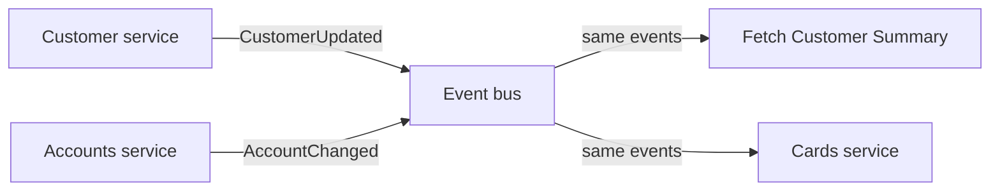


**Example:** customer changes mobile number. Customer service publishes `CustomerUpdated`. Accounts, Cards, Loans each listen and update the copy they store locally.

**Say:** the bus **decouples** sender from receivers. Delivery is **asynchronous** → **eventual consistency** (copies catch up a moment later).

---


## Aggregate (DDD)

**Simple definition:** an aggregate is a **small group of related domain objects that must stay valid together**. It has one public entry point: the **aggregate root**.

Think: “What must be checked and saved together in one transaction?”


|             |                                                                                                                                                                        |
| ----------- | ---------------------------------------------------------------------------------------------------------------------------------------------------------------------- |
| **Problem** | If any code can change every object independently, business rules can break. Example: a line item changes but the order total is not updated.                          |
| **Solved**  | Put objects with rules that need **immediate consistency** into one aggregate. Change them only through its **root**, which checks the rules.                          |
| **Used**    | An **aggregate root** with an ID; child **entities** and **value objects**; one local DB transaction. Other aggregates refer to it by **ID**, not by object reference. |


### Example — Order aggregate

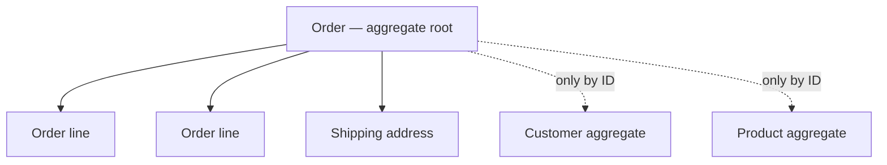


`Order` is the root. Code calls `order.addItem(productId, price, quantity)`, not `lineItem.changePrice()` directly.

The order checks invariants such as:

- total = sum of order lines
- an order cannot be confirmed with no items
- a cancelled order cannot be shipped

Then it saves the **whole Order aggregate** together. `Customer` and `Product` are separate aggregates because they have their own lifecycles and rules; Order stores only their IDs.

### Connection to Event Sourcing

Aggregate is a **DDD concept**; it does **not** require event sourcing.

With ordinary persistence, `Order` loads state from tables, checks rules, and saves updated rows. With event sourcing, `Account` loads prior events, rebuilds its state, checks `DebitMoney`, and appends `MoneyDebited`. The aggregate concept is the same; only its storage method differs.

**Say in an interview:** “An aggregate is a consistency boundary. The aggregate root controls changes and enforces invariants, so related objects are valid when saved. I keep aggregates small and reference other aggregates by ID. In event sourcing, an aggregate rebuilds state from its events before deciding which new event to append.”

---


## 2. API composition (API Composer) — bank dashboard


|             |                                                                                                                                             |
| ----------- | ------------------------------------------------------------------------------------------------------------------------------------------- |
| **Problem** | **Cross-service query.** Dashboard needs customer + accounts + loans + cards. Data lives in **four DBs**. SQL JOIN is impossible.           |
| **Solved**  | One call from the client. Composer **calls each provider service** and **merges** the JSON into one dashboard payload.                      |
| **Used**    | **API composer** (client, **API Gateway** / Gateway Aggregator, or standalone service) + **provider APIs** + **parallel/reactive** fan-out. |


**Need:** in a monolith you JOIN tables. With database-per-service you **cannot JOIN**. The customer wants **one screen**: personal info + accounts + loans + cards.

**Course definition:** run a query by calling the **provider services** that own each piece of data, then **compose** (merge) the results. The component that does the merge is the **API composer**.

Composer can live in:

1. the **client**
2. the **API Gateway** (Gateway Aggregator — this is the dashboard example)
3. a **standalone** service

They recommend a **reactive / parallel** fan-out so you do not wait sequentially.

### Dashboard example from the PDF

Client wants the **customer portal / dashboard** (balance, cards, last transactions, loans, profile). Gateway is the composer:

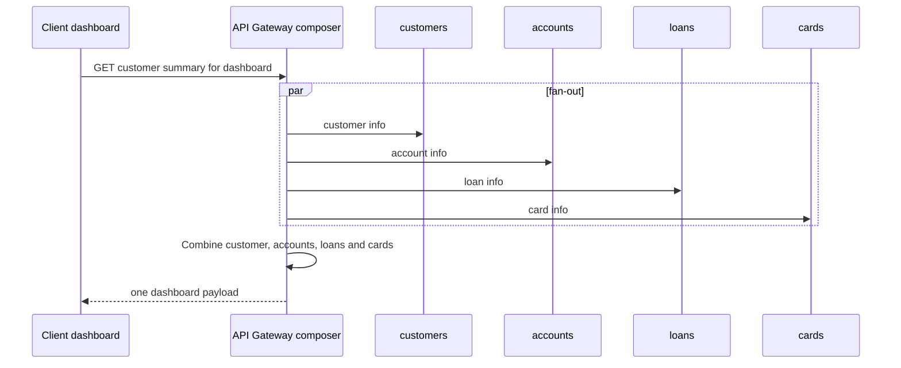


Each of those four services reads **only its own DB**.

**Drawbacks the course lists:** extra **latency** (slowest call), **complex merge logic**, **partial failures**, **inconsistent snapshot** (services answered at slightly different times), composer can become a **bottleneck**, **availability** depends on every downstream service.

**Say:** simplest way to query across services — **use it when you can**. If the dashboard is hot / must stay up if one service is down, prefer **CQRS + materialized view** (next).

---


## 3. CQRS: **Command Query Responsibility Segregation**. It separates operations that change data (**commands**) from operations that read data (**queries**)


|             |                                                                                                                                                                                                                         |
| ----------- | ----------------------------------------------------------------------------------------------------------------------------------------------------------------------------------------------------------------------- |
| **Problem** | API composition hits **four services on every dashboard load**: slow, fragile, merge logic in the gateway. Writes and reads also need **different shapes** (normalized vs denormalized).                                |
| **Solved**  | **Commands** go to write models/DBs. **Queries** go to a **ready-to-read view** (Customer Summary). Reads can scale and look different from writes.                                                                     |
| **Used**    | Separate **Write APIs / Command / Write DB** and **Read APIs / Query / Read DB**. Sync via **event bus** (or same DB in simple CQRS). Bank: events from four services → **Fetch Customer Summary** → **view database**. |


**Need:** same dashboard, but without live fan-out on every page load.

**Definition (course):** separate **commands** (change state) from **queries** (read state).

Write path: Write APIs → Command → **Write DB**.  
Bridge: write side publishes to the **event bus**.  
Read path: **Read DB** ← Query ← Read APIs.

### Bank example from the PDF

Customer, Accounts, Loans, Cards **each publish events** (`customer event`, `account event`, …) to the **event bus**. A **Fetch Customer Summary** service listens, and writes a **Customer Summary view database** — ready for the dashboard.

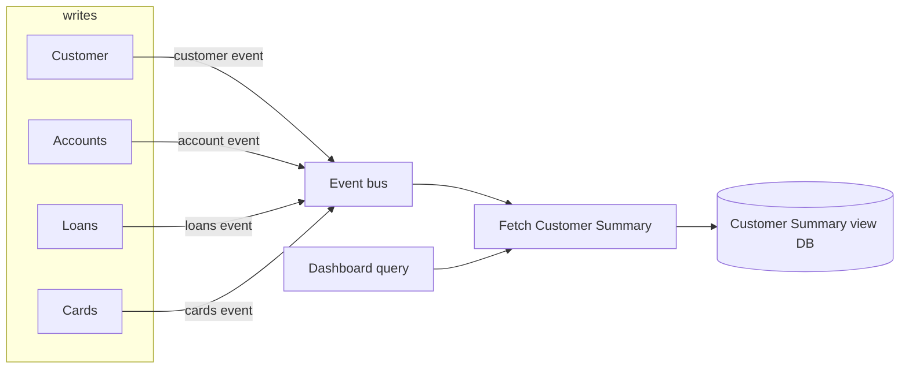


**Advantages (course):** scale reads vs writes separately; write model for consistency, read model for fast queries; extra views/projections; pairs well with event sourcing.

**Disadvantages (course):** more complexity, **eventual consistency**, two models to build and keep in sync.

Course also shows milder CQRS (same DB, or two models one DB = **strong consistency**). Separate read/write DBs + bus = **eventual consistency**, high scale.

**Say:** CQRS is **not** event sourcing. Event sourcing is one way to implement the write side.

---


## 4. Event sourcing


|             |                                                                                                                                                                                        |
| ----------- | -------------------------------------------------------------------------------------------------------------------------------------------------------------------------------------- |
| **Problem** | Storing only `balance = 2150` loses **how** you got there. No audit, no “balance last Tuesday,” hard to rebuild after a bug. CQRS write side also needs a reliable history of changes. |
| **Solved**  | Source of truth is the **event log**. Replay → current state or state at time T. New **projections** without changing the write model.                                                 |
| **Used**    | **Commands**, **events**, **event store**, **aggregate**, **projections**. Often paired with CQRS + event bus.                                                                         |


**Need:** persist **what happened**, not only the latest row.

**Definition (course):** every change is an **event** in an append-only **event store**. Rebuild state by **replaying** the log.


| Piece           | Meaning                                                   | Course example                  |
| --------------- | --------------------------------------------------------- | ------------------------------- |
| **Command**     | **Intent** to do something                                | `DebitMoney`, `CreditMoney`     |
| **Event**       | **Immutable fact** that already happened                  | `MoneyDebited`, `MoneyCredited` |
| **Event store** | Ordered log of events                                     | Bank Account Event Store        |
| **Aggregate**   | Object with state + behavior; produces and applies events | account / transaction aggregate |
| **Projection**  | Read-only view built from events                          | current balance for UI          |


Replaying events is mainly useful for rebuilding state—not for every read

**Bank example (PDF numbers):**

1. +2000 credited
2. −120 debited
3. −50 debited
4. +500 credited
5. −80 debited
6. −100 debited

Replay → **current balance $2150**. You can also stop at any date and get the balance **at that time**.

**Benefits (course):** audit trail, replay / “time machine”, scale with CQRS, new projections without changing the write model.

---


## 5. Snapshot


|             |                                                                                                                                             |
| ----------- | ------------------------------------------------------------------------------------------------------------------------------------------- |
| **Problem** | Before a new command, the aggregate **replays every event**. Thousands of credits/debits → slow load, high latency.                         |
| **Solved**  | Save aggregate state every N events. Restore = **latest snapshot + events after it**, not the full history.                                 |
| **Used**    | Snapshot store (often beside the event store), **same aggregate id**, frequency e.g. every 100 events. Event log stays the source of truth. |


**Need (course):** before appending a new event, the aggregate **replays all past events**. A busy account with thousands of events makes that slow.

- **Projection:** A view maintained(saved balance) for queries, such as the current balance table.
- **Snapshot:** Saved state at a specific event position, such as “balance = 120 after event #1,000.” To restore state, load that snapshot and apply only events #1,001 onward.

**How:**

1. After every N events (e.g. 100), save the **aggregate’s current state** as a snapshot (same aggregate id).
2. To restore: load **latest snapshot**, replay only events **after** it.

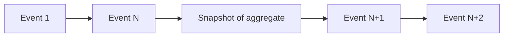


To get state after N+2: start at snapshot, apply N+1 and N+2 — skip 1…N.

**Trade-offs (course):** extra storage, how often to snapshot, snapshot must stay valid.

**Say:** snapshot is **performance**, not the source of truth. Truth is still the event stream.

---


## 6. Saga — distributed business transaction


|             |                                                                                                                                                                                                                                                                     |
| ----------- | ------------------------------------------------------------------------------------------------------------------------------------------------------------------------------------------------------------------------------------------------------------------- |
| **Problem** | One business process spans services (**order + payment + inventory**, or **car + hotel + flight**, or **mobile number in 4 bank DBs**). No shared DB → no single SQL transaction. If a later step fails, earlier commits stay forever. **2PC** is too slow/locking. |
| **Solved**  | A **chain of local transactions**. Success = all **T** steps. Failure = **compensating C** steps **in reverse**. Eventual consistency, services stay independent.                                                                                                   |
| **Used**    | Local DB commits per service. **T / C** pairs. **Choreography** (events: each service notifies the next) **or orchestration** (**saga manager** sends commands; often with CQRS).                                                                                   |


**Need (course):** one business action touches **several services + several DBs**. Example: e-commerce **create order → deduct payment → update inventory**. If payment fails after the order exists, data is wrong. There is **no shared DB**, so you cannot use one SQL transaction.

**Definition (course):** break one big transaction into a **series of small local transactions**. Each service **commits to its own DB**. If a later step fails, **compensating transactions** undo the earlier ones.

Notation from the PDF:

- **T1, T2, … Tn** = local transactions (forward path)
- **C1, C2, … Cn** = compensating transactions (undo **Ti**)
- If **T(n+1)** fails, run **Cn, C(n-1), … C1** in **reverse order**
- Each Ti was **already committed** in that service’s DB — compensation is a **new** transaction (cancel booking, refund), not a DB `ROLLBACK` of a global lock

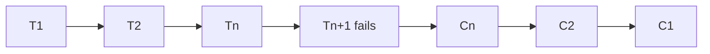


**Happy path:** all Ti succeed → saga completes.  
**Failure path:** some Ti fails → rollback path of Ci.

### Example A — vacation booking (PDF)

User books an itinerary:


| Step | Service | Forward (T)                            | Compensation (C)                |
| ---- | ------- | -------------------------------------- | ------------------------------- |
| 1    | Car     | `T1 /reserveCar` — update car DB       | `C1 /cancelCarBooking`          |
| 2    | Hotel   | `T2 /reserveHotel` — update hotel DB   | `C2 /cancelHotelBooking`        |
| 3    | Flight  | `T3 /reserveFlight` — update flight DB | (if this fails, run C2 then C1) |


If the flight cannot be reserved, hotel and car reservations are **cancelled** in reverse order.

### Example B — bank, update mobile number (PDF)

Same number is stored in four DBs (duplication). Request: update mobile.

Forward: `T1 /updateCusMob` → `T2 /updateAccMob` → `T3 /updateCardMob` → `T4 /updateLoanMob`.

If Loans fails: `C3 /rollbackCardMob` → `C2 /rollbackAccMob` → `C1 /rollbackCusMob`.

### Two implementations (PDF)

**Choreography (decentralized)** — dancing without a conductor. Each service knows **its own T/C** and **whom to notify next**. No central boss. Car success triggers Hotel, Hotel success triggers Flight; Flight failure publishes an event Hotel listens to for C2, and so on. Used with **events**.

**Orchestration (centralized)** — like a **conductor**. A **Saga manager / orchestrator** **sends commands** to each service and sequences the flow. Course note: orchestration is **commonly used when CQRS is implemented**. Bank diagram: Customer service holds the Saga manager and **directs** Accounts, Cards, Loans for the mobile-number update. If one fails, the manager tells the others to compensate.

**Benefits (course):** consistency without classic distributed transactions; each step can scale; compensating txs give resilience; you can pick choreography or orchestration.

**Drawbacks (course):** complexity (especially compensations), **eventual consistency**, hard to test/debug failure paths.

**Say:** saga = **local commit + compensate**. Not one ACID transaction across services.

---


## 7. Two-phase commit (2PC)


|             |                                                                                                                                                                                        |
| ----------- | -------------------------------------------------------------------------------------------------------------------------------------------------------------------------------------- |
| **Problem** | Two resources must stay atomic (e.g. **Accounts DB + Kafka**, or two databases). Dual write without coordination: crash after DB / before Kafka → lost event; Kafka yes / DB no → lie. |
| **Solved**  | **All commit or all abort.** Coordinator **PREPARE** then **COMMIT/ROLLBACK**. Strong consistency across nodes.                                                                        |
| **Used**    | **Coordinator** + **resource managers** (DBs, broker) + locks until phase 2. XA / 2PC. Course: **avoid** for microservices; use **Transactional Outbox** instead.                      |


Imagine your Accounts service must do **two things** when an account changes:

1. Save the change in its database.
2. Tell Kafka so analytics can use it.

**The problem:** If these are separate actions, the service could save to the DB and then crash before telling Kafka. The account changed, but analytics never hears about it.

### Two-phase commit (2PC)

2PC tries to make the DB and the other system act as **one transaction**:

- **Phase 1 — Prepare:** Ask both, “Are you ready to commit?”
- **Phase 2 — Decide:** If both say yes, tell both to commit. Otherwise, tell both to abort.

The cost is that the systems must wait for each other, and resources may stay locked while they wait. Also, this example assumes the broker (A **broker** is the system that receives messages from producers and makes them available to consumers) can participate in that coordinated transaction; an ordinary Kafka publish does not automatically do so.

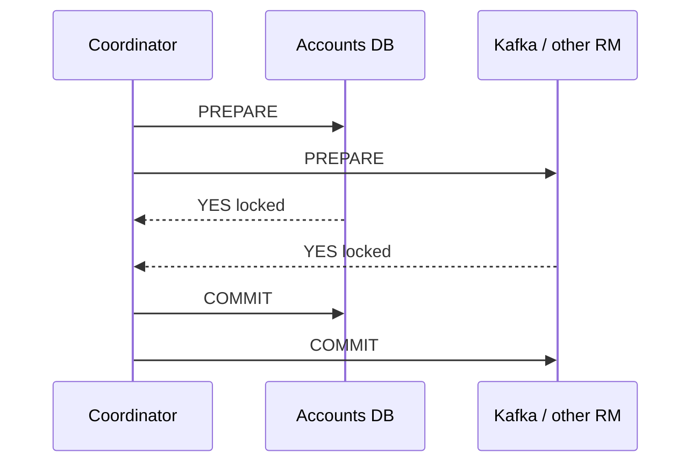


In two-phase commit, what happens in the prepare phase and the commit phase. "prepare" is more than a readiness check. Each participant has already done its work without committing, records that it can commit, and may keep locks while waiting for the coordinator's decision. The coordinator then tells all to commit, or tells them to roll back if preparation failed. If it crashes after everyone prepares, participants can sit "in doubt", holding resources until recovery decides. They can't safely assume commit or rollback. suppose the coordinator recorded a decision to commit, told database A, then crashed before telling database B. 

What should happen when it restarts?

In 2 phase commit, on restart, the coordinator reads its durable "commit" decision and tells database B to commit its prepared transaction. If B is down, it keeps retrying, and B may hold locks while prepared.

### Transactional Outbox (what the course uses instead of 2PC)


|             |                                                                                                                                                                                     |
| ----------- | ----------------------------------------------------------------------------------------------------------------------------------------------------------------------------------- |
| **Problem** | Same dual-write problem (DB + Kafka) without 2PC’s locks.                                                                                                                           |
| **Solved**  | Business row and **outbox row** commit in **one local DB transaction**. Later, a poller or **CDC** publishes outbox → Kafka. Event is not published unless the DB commit succeeded. |
| **Used**    | **Account table + Outbox table**, then **polling** or **Debezium (CDC)** → **Kafka**.                                                                                               |


Instead, save **two rows in the same database transaction**: the account change and an “event to publish” in an outbox table.

If that transaction succeeds, both rows exist. A separate worker later reads the outbox row and publishes it to Kafka. If Kafka is unavailable, the worker can retry later. Analytics may receive the event **later**, and possibly more than once, so it should handle duplicates.


|                                | 2PC                                             | Transactional outbox                     |
| ------------------------------ | ----------------------------------------------- | ---------------------------------------- |
| What commits together?         | DB and another participating system             | Account row and outbox row in **one DB** |
| When does Kafka get the event? | As part of the coordinated commit, if supported | Later, from the outbox                   |
| Main tradeoff                  | Waiting and coordination                        | Delay and possible duplicate delivery    |


**Memory aid:** 2PC says **“everyone commit together.”** Outbox says **“save the promise to publish with the account change, then fulfill that promise.”**

Note: So the behavior you described—**either the DB write and Kafka publish both commit, or both roll back**—is the *goal of a distributed transaction such as 2PC*. It is **not** what `@Transactional` alone guarantees across a database and Kafka. Kafka’s own transactions can make Kafka writes atomic, but they do not automatically include your SQL DB write. 

The outbox is the practical alternative: commit **account + event record in the DB**, then reliably send the event record to Kafka afterward.

---


## 8. Domain-driven design (DDD)

Eric Evans (2003). Software should **look like the business**. Business and engineering use the **same words**. Find subdomains **with the business**, not only engineers.


|             |                                                                                                                                                                                                             |
| ----------- | ----------------------------------------------------------------------------------------------------------------------------------------------------------------------------------------------------------- |
| **Problem** | Complex product, everyone names things differently. One giant model (`Customer` everywhere) does not match how the business actually works.                                                                 |
| **Solved**  | Split the business into **subdomains**, each with its own **language and model**. Code = the domain.                                                                                                        |
| **Used**    | **Strategic design** first (subdomains, ubiquitous language, bounded contexts, context map, anti-corruption layer), then **tactical design** (entity, value object, aggregate, repository, domain service). |


### Interview answer — “Do you know DDD?”

> DDD is designing software around the **business domain**, not around tables or screens. We agree a **ubiquitous (wide spread, very common**) **language** with the business, split the domain into **subdomains**, and give each one a **bounded context** so the same real-world person c++an be a **subscriber** in Billing a++nd a **viewer** in Streaming. Inside a context we model **entities**, **value objects**, and **aggregates** (consistency + invariants). Contexts talk through a **context map**, often with an **anti-corruption layer** so we do not leak Billing into Streaming. CQRS, event sourcing, and saga are **tactics inside** a context — they are not DDD by themselves.

Netflix-style example: **core domain** = video streaming. Other subdomains: **recommendations**, **billing**. Streaming only cares about quality (HD / Full HD / Ultra HD). Billing only cares about the **plan**. Streaming does not store prices; it maps **viewer → subscriber** through an ACL.

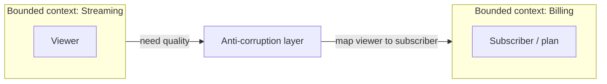


### Terms (memorize this table)

**Strategic (big picture)**


| Term                            | Meaning                                                 | Interview one-liner                                                                                            |
| ------------------------------- | ------------------------------------------------------- | -------------------------------------------------------------------------------------------------------------- |
| **Domain**                      | The subject you are building (Netflix, banking).        | “The business we are in.”                                                                                      |
| **Subdomain**                   | A part of that business.                                | Streaming vs billing vs recommendations.                                                                       |
| **Core domain**                 | The part that makes you money / unique.                 | Netflix: **video streaming**.                                                                                  |
| **Ubiquitous language**         | Same words in meetings **and** in code.                 | Do not say `UserDto` if the business says **subscriber**.                                                      |
| **Bounded context**             | A wall around one model + one language.                 | Billing: **customer/subscriber**. Streaming: **viewer**. You do **not** force the whole company onto one name. |
| **Context map**                 | Who talks to whom, **how**, and in which **direction**. | Streaming **asks** Billing for plan → quality.                                                                 |
| **Anti-corruption layer (ACL)** | Translator at the boundary.                             | Map viewer ↔ subscriber so neither model is polluted.                                                          |


**Tactical (inside one context)**


| Term               | Meaning                                                                                                                                                                                                                                                    | Interview one-liner                                                                                                                                                 |
| ------------------ | ---------------------------------------------------------------------------------------------------------------------------------------------------------------------------------------------------------------------------------------------------------- | ------------------------------------------------------------------------------------------------------------------------------------------------------------------- |
| **Entity**         | Real-world thing with an **ID**. Mutable. Same ID = same thing even if email changes.                                                                                                                                                                      | Subscriber id stays; email can change.                                                                                                                              |
| **Value object**   | A **value**, no identity. **Immutable**. Equal if values equal. Validation in the constructor.                                                                                                                                                             | `Email`, `DateOfBirth`. Two `Email("a@x.com")` are the same. Address is often a VO; in **real estate** address may be an **entity**. Prefer more VOs than entities. |
| **Aggregate**      | Cluster of entities + VOs treated as **one unit**. Has an **ID**. **Transactional boundary**: commit or roll back together. Enforces **invariants** (order total = sum of lines; cannot order more than stock). Keep it **small** — too many rules = slow. | Order = customer + lines + price + shipping address.                                                                                                                |
| **Invariant**      | A rule that must **always** be true inside the aggregate.                                                                                                                                                                                                  | Order total = sum of products.                                                                                                                                      |
| **Repository**     | Persistence for **aggregates** (load/save by id).                                                                                                                                                                                                          | `OrderRepository.save(order)`.                                                                                                                                      |
| **Domain service** | Logic that **does not fit one aggregate** or **spans several**.                                                                                                                                                                                            | Place-order that touches Order + Inventory.                                                                                                                         |


> DDD means learning how the business works with business experts, then reflecting its concepts and rules in the software. A business can have different areas, such as authentication, billing, and streaming. The same person can be called a **user** in authentication and a **subscriber** in billing, because each area cares about different things.

**A subdomain and a bounded context are related, but they are not the same thing.** A *subdomain* is an area of the business, such as billing. A *bounded context* is the boundary where one software model and its words have a specific meaning. One bounded context does not automatically mean one microservice.

**An aggregate is not communication between entities.** It is a group of related data that must follow certain business rules together. For example, an `Order` and its `OrderLines` can form an aggregate: the Order controls changes so you cannot confirm an empty order. Those changes can be saved in one transaction.

---


## 9. Strangler Fig

Named after a tree that **grows around** another tree until the old one dies. Martin Fowler / microservices migration.


|             |                                                                                                                                                                                                                                                                                                        |
| ----------- | ------------------------------------------------------------------------------------------------------------------------------------------------------------------------------------------------------------------------------------------------------------------------------------------------------ |
| **Problem** | Legacy **monolith**: one codebase, one DB, one deploy. Slow to scale, scary to change. A **full rewrite** takes months; if it fails, customers and revenue take the hit.                                                                                                                               |
| **Solved**  | Keep the monolith **running**. Rebuild **one feature** as a microservice, **route that traffic** to the new service. Repeat. Monolith shrinks until you retire it (or leave a tiny admin/fallback).                                                                                                    |
| **Used**    | **API gateway / routing layer**. New service + **its own DB**. Copy/sync old tables at first (jobs, events, or read-through APIs) — then **stop reading the monolith DB**. Cross-feature calls = **APIs**, not shared tables. Pick a first slice that is **high traffic, low risk, few dependencies**. |


### Interview answer — “What is the Strangler Fig pattern?”

> Instead of a big-bang rewrite, we put a **gateway** in front of the monolith and **strangle** it feature by feature. We extract e.g. **product catalog** into a new service with its **own database**, then route homepage/category traffic there. Cart and checkout still hit the monolith. Then we extract reviews, order history, and so on. Risk stays low, the site stays up, teams can work in parallel. When almost nothing is left on the monolith, we switch it off.


### E-commerce flow

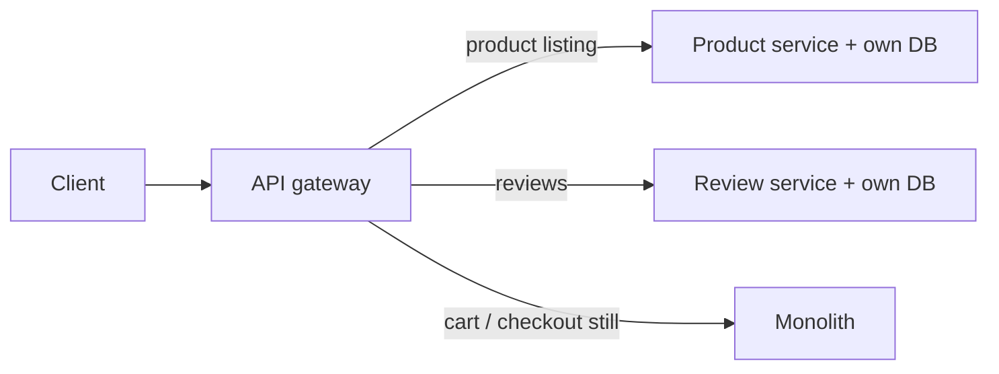


1. Build **Product service** (names, prices, images, own DB).
2. Gateway: homepage/browse → **new** service; cart/orders → **monolith**. That **is** strangler fig.
3. Same for **reviews**, then history / checkout / profile.
4. Data: copy relevant tables or sync; **going forward the new service owns the data**. Inventory during checkout = **API**, not a join on the old DB.
5. End: monolith gone, or leftover admin only.

**Why interviewers like it:** no 6-month freeze; you only migrate what you understand; independent deploy/scale/test without killing the legacy app.

**Say:** first slice = **seams** you can route (URL, module). Never let the new service **reach into** the monolith database as the long-term design.

---


## 10. Hexagonal architecture (ports and adapters)

Alistair Cockburn. Same idea as **ports and adapters**. The hexagon is just a drawing: **core in the middle**, one side per input/output. Many hexagons = honeycomb (one hexagon per DDD subdomain).


|             |                                                                                                                                                                                                                                                 |
| ----------- | ----------------------------------------------------------------------------------------------------------------------------------------------------------------------------------------------------------------------------------------------- |
| **Problem** | **Three-tier** (presentation / logic / data) is a start, but layers get **tightly coupled**. Core logic calls Postgres, REST, or AWS directly. Hard to test, hard to swap DynamoDB, hard to trigger the same logic from an API **and** a queue. |
| **Solved**  | **Domain core knows nothing** about HTTP, Kafka, or SQL. It only talks through **ports** (contracts). **Adapters** convert the outside world to those contracts. Swap DB or add a queue consumer without touching business rules.               |
| **Used**    | **Driving** (input) adapters: REST controller, message listener. **Driven** (output) adapters: DB, file, email, another hexagon. Ports = interfaces **owned by the core** (`save`, `load` — not `IDbRepository`). DI to plug adapters.          |


### Interview answer — “What is hexagonal architecture?”

> Also called **ports and adapters**. The **application core** (domain) sits in the middle. A **port** is a contract the core defines: “I need to read/write data” — it does not care if that is SQL, files, or a queue. An **adapter** implements that port for a real technology. **Driving** side = inputs that **push** the app (API, UI, Kafka consumer). **Driven** side = outputs the app **calls** (DB, email, other services). Same use-case runs whether the trigger was HTTP or a message. DDD: one hexagon per bounded context, connected by ports.

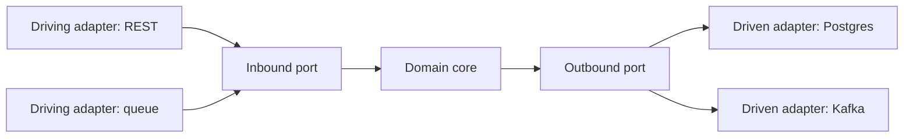


**Vs three-tier:** presentation / logic / data still exist, but the **core does not import Spring/JPA**. Adapters sit at the edge.

**Terms**


| Term               | Meaning                                                                            |
| ------------------ | ---------------------------------------------------------------------------------- |
| **Port**           | Interface the **core** owns. No DB words.                                          |
| **Adapter**        | Converts port ↔ HTTP body, SQL, DynamoDB API, etc. Change adapter, **port stays**. |
| **Driving / left** | Outside **drives** the app (API, UI, message).                                     |
| **Driven / right** | App **drives** the outside (DB, mail, other hexagon).                              |


**Pros:** easy **unit tests** (fake ports); **swap tech** (Postgres → DynamoDB = new adapter); extra processing = another hexagon on a port.

**Cons:** more code/interfaces; local run can feel like **many services**; many hexagons talking over HTTP = **latency**.

**When to use:** large app, many I/O, long-lived, you will change DBs or add consumers. **Skip** for a small CRUD app — not worth it. Do not rewrite a mature system “just for hexagons”; introduce it the next time you add an input or replace a technology.

**Say with DDD:** hexagonal is **how you structure the code** of a bounded context. DDD is **what the core models**.

---


## 11. Proxy (structural) — Geekific

GoF structural pattern. Same idea as a **proxy server**: the client talks to a stand-in, not the real object. The stand-in can **filter, cache, lazy-create, or log**, then **forward** the call.


|             |                                                                                                                                                                                                                           |
| ----------- | ------------------------------------------------------------------------------------------------------------------------------------------------------------------------------------------------------------------------- |
| **Problem** | You need to do something **before/after** a call (ban a URL, cache a download, delay creating an expensive object). Putting that inside the real class either **breaks all callers** or **mixes extra concerns** into it. |
| **Solved**  | A **proxy** implements the **same interface** as the real object, so the client cannot tell them apart. Extra work happens in the proxy; the real object stays focused on its job.                                        |
| **Used**    | Shared **Service** interface. **RealService** = business logic. **Proxy** holds a reference to RealService, does its extra work, then **delegates**. Client depends only on the interface.                                |


**Need (video):** if `Internet.connectTo()` itself bans sites, **nobody** on the network can open them. You need an **intermediary** that checks the request, then either denies it or forwards it.

**Definition:** provide a **substitute / placeholder** for another object. It **controls access** to the original: do work **before or after** the request reaches it.

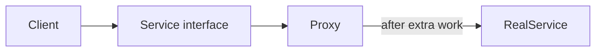


### What else a proxy can do


| Kind                | Extra work                                 | Spring / Java you already know                                 |
| ------------------- | ------------------------------------------ | -------------------------------------------------------------- |
| **Protection**      | Auth / deny a call                         | security filter in front of a service                          |
| **Cache**           | Return a stored result; skip the real call | cache around a repository                                      |
| **Virtual / lazy**  | Create the real object only on first use   | Spring lazy bean, Hibernate lazy-load proxy                    |
| **Remote**          | Local stub that talks over the network     | RMI / Feign-style client                                       |
| **Logging / smart** | Log, count, retry around the real call     | Spring **AOP** / `@Transactional` (JDK dynamic proxy or CGLIB) |


### Not the same as — Adapter vs Proxy vs Decorator

All three **wrap** another object. Interviewers mix them because the class diagram looks similar: a wrapper + a field pointing at the wrapped thing. The difference is **intent**.

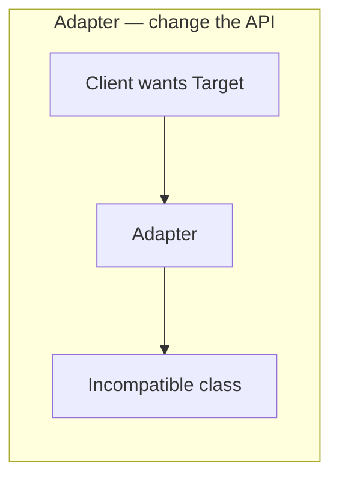


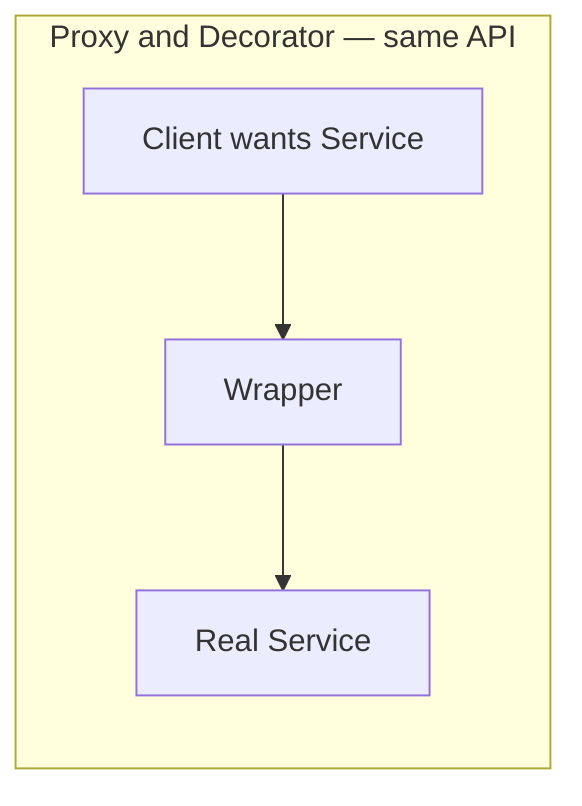


#### Adapter — make a square peg fit a round hole


|             |                                                                                                                                                                                         |
| ----------- | --------------------------------------------------------------------------------------------------------------------------------------------------------------------------------------- |
| **Problem** | You need interface `PaymentGateway.charge(Money)`, but the library you have is `LegacyPay.makePayment(double)`. Different method names, different types. You cannot change the library. |
| **Solved**  | An **adapter** implements the interface the **client already uses**, and **translates** each call into the old API.                                                                     |
| **Used**    | `class StripeAdapter implements PaymentGateway { LegacyPay inner; charge(m) { inner.makePayment(m.toDouble()); } }`                                                                     |


**Key:** Adapter **changes the interface**. After wrapping, the client never sees `LegacyPay`. EU plug → US socket. In Java: `Arrays.asList`, `InputStreamReader` (byte stream → character stream), wrapping a third-party SDK.

**Vs Proxy:** Proxy pretends to **be** the same type (`Internet` stays `Internet`). Adapter **renames/reshapes** the type so an incompatible class can be used.

#### Decorator — add behavior, and stack it


|             |                                                                                                                                                               |
| ----------- | ------------------------------------------------------------------------------------------------------------------------------------------------------------- |
| **Problem** | You want logging, compression, encryption on a stream. Subclassing every combo (`LoggedGzipFile`, `EncryptedLoggedFile`…) explodes.                           |
| **Solved**  | A **decorator** implements the **same** interface, holds the real object, **always forwards**, and adds work around the call. Decorators wrap **each other**. |
| **Used**    | `gzip(log(encrypt(file)))`. Java I/O: `new BufferedInputStream(new GZIPInputStream(new FileInputStream(f)))`.                                                 |


**Key:** Decorator **adds responsibilities**. The client often **builds the stack**. Call almost always reaches the real object (plus extras). Open/closed: new wrapping without touching the core class.

**Vs Proxy:** Same interface + wrap — that is why they get confused.


|                                  | **Proxy**                                               | **Decorator**                                     |
| -------------------------------- | ------------------------------------------------------- | ------------------------------------------------- |
| **Intent**                       | **Control access** to the real object                   | **Add** behavior                                  |
| **May skip** the real call?      | **Yes** — deny, cache hit, not created yet              | **Rarely** — it exists to enhance the call        |
| **Who creates** the real object? | Often the **proxy** (client thinks it *is* the service) | Usually the **client** (you pass in what to wrap) |
| **How many wrappers?**           | Usually **one**, 1:1 with the real object               | **Stack** — gzip ∘ log ∘ encrypt                  |
| **Client knows?**                | No — substitute / placeholder                           | Yes — you composed the extras                     |


Spring `@Transactional` is a **proxy** (access/lifecycle around the method, you did not stack it). `BufferedInputStream` is a **decorator** (you wrapped a stream on purpose).

**Say:** “Proxy is a stand-in with the **same** interface: deny, cache, or lazy-create, then maybe delegate. Adapter **changes** the interface so an old class fits. Decorator **keeps** the interface and **adds** stacked behavior. In Spring, `@Transactional` and lazy JPA entities are proxies.”

---


## Extra interview terms


### Materialized view (in the PDF — dashboard without live fan-out)


|             |                                                                                                                                                                                                           |
| ----------- | --------------------------------------------------------------------------------------------------------------------------------------------------------------------------------------------------------- |
| **Problem** | Dashboard from many services: API composition is slow / unavailable if one provider is down.                                                                                                              |
| **Solved**  | Keep a **local denormalized copy** (`CustomerBankView`) and answer the UI from that DB.                                                                                                                   |
| **Used**    | Subscribe to events (`CustomerProfileUpdated`, `AccountTransactionPerformed`, …) via **Kafka**; **event handlers** update the view DB; **QueryHandler** serves the UI. This is the **read side of CQRS**. |


### BDD


|             |                                                                                            |
| ----------- | ------------------------------------------------------------------------------------------ |
| **Problem** | Dev, QA, and business disagree on what “done” means. Tests encode UI clicks, not behavior. |
| **Solved**  | Shared **examples of behavior** that become automated tests.                               |
| **Used**    | **Given / When / Then** (Gherkin / Cucumber, etc.). Keep scenarios on **outcomes**.        |


Specify behavior as **Given / When / Then** with the business, then automate it. Example: *Given an account with $2150, When DebitMoney 100, Then MoneyDebited is stored and balance view is $2050.*

---


## GoF design patterns — 10 in 10 minutes (Fireship)


| Bucket         | Question                         | Patterns                               |
| -------------- | -------------------------------- | -------------------------------------- |
| **Creational** | How is the object **created**?   | Singleton, Prototype, Builder, Factory |
| **Structural** | How do objects **fit together**? | Facade, Proxy                          |
| **Behavioral** | How do objects **talk**?         | Observer, Strategy                     |


---


### Creational


#### Singleton — only one instance


|             |                                                                                                                                           |
| ----------- | ----------------------------------------------------------------------------------------------------------------------------------------- |
| **Problem** | Many copies of global config / a connection pool fight each other. You need **one** shared object.                                        |
| **Solved**  | Class controls its own creation: **private constructor** + static `getInstance()`. Second call returns the same object.                   |
| **Used**    | `private` ctor, `static` instance, `getInstance()`. Java **enum** singleton is the safe version. Spring: default bean scope is singleton. |


```java
enum Settings { INSTANCE; }          // preferred in Java
// or Spring: @Component  → one bean per context, no hand-rolled Singleton
```

**Con:** global mutable state, hard to test, hidden dependency. In JS the video says a module-level object already is a singleton — extra class is noise. Same in Spring: **do not** write `getInstance()` if the container already gives you one bean.

#### Prototype — clone


|             |                                                                                        |
| ----------- | -------------------------------------------------------------------------------------- |
| **Problem** | Need a copy of an existing object, not `new` from scratch.                             |
| **Solved**  | **Clone** it. That **is** the Prototype pattern.                                       |
| **Used**    | Java: **copy constructor** (preferred) or `Cloneable` / `clone()`. Shallow by default. |


```java
Sheep copy = new Sheep(original);   // copy ctor
Sheep copy = original.clone();      // Cloneable — awkward, shallow
```


#### Builder — construct step by step


|             |                                                                                                                                        |
| ----------- | -------------------------------------------------------------------------------------------------------------------------------------- |
| **Problem** | Constructor has 8 args (`ketchup, mustard, onions…`). Easy to mix up; you cannot pause mid-build.                                      |
| **Solved**  | Set options with **methods**, then `build()`. Each method returns `this` → **fluent chaining**. Can move build logic to another class. |
| **Used**    | Inner `Builder`, Lombok `@Builder`, `StringBuilder`, Testcontainers / RestAssured DSLs.                                                |


```java
HotDog dog = new HotDog.Builder()
    .ketchup()
    .mustard()
    .onions()
    .build();
```

**Vs Factory:** Factory **picks a type**. Builder **fills in a complex object** of a type you already know.

#### Factory — “don’t `new` in the client”


|             |                                                                                                                                                             |
| ----------- | ----------------------------------------------------------------------------------------------------------------------------------------------------------- |
| **Problem** | Client is full of `if ios → new IosButton(); if android → new AndroidButton()`. Same `if` copied everywhere. Adding a platform means touching every caller. |
| **Solved**  | A **function/class** decides which concrete type to construct. Client depends on the **interface**.                                                         |
| **Used**    | Simple factory / factory method. `ButtonFactory.create(os)`. Spring still uses this idea (`DataSource`, `NotificationSender`).                              |


```java
interface Button { void render(); }

class ButtonFactory {
    static Button create(String os) {
        return "ios".equals(os) ? new IosButton() : new AndroidButton();
    }
}
```

**Say:** Factory hides **which class**. Builder hides **how many steps**. If they ask **Abstract Factory**: a factory of factories (a family of related objects — iOS button+checkbox vs Android button+checkbox).

---


### Structural


#### Facade — one simple API over many internals - الواجهة (dashboard)

**Definition:** a class that sits in front of **several** subsystems and gives callers **one small API**. The caller does not know (or call) inventory, payment, DB, and Kafka separately.


|             |                                                                                                                                              |
| ----------- | -------------------------------------------------------------------------------------------------------------------------------------------- |
| **Problem** | Every controller/job repeats the same 5 calls: reserve stock, charge card, save order, publish event, send email. Internals leak everywhere. |
| **Solved**  | One **facade** method (`placeOrder`) owns that sequence. Callers depend on the facade only.                                                  |
| **Used**    | Application/service layer in a large Spring app. Also: `JpaRepository.save()` over JDBC/Hibernate; Slf4j over the real logger.               |


Daily example — checkout in a large backend. The REST controller does **not** inject 4 clients:

```java
@RestController
class OrderController {
    private final OrderFacade orders;
    @PostMapping("/orders")
    OrderResult create(@RequestBody PlaceOrderRequest req) {
        return orders.placeOrder(req.toCommand());
    }
}

class OrderFacade {
    private final InventoryClient inventory;
    private final PaymentClient payment;
    private final OrderRepository repo;
    private final KafkaTemplate<String, OrderPlaced> kafka;

    OrderResult placeOrder(PlaceOrderCommand cmd) {
        inventory.reserve(cmd.items());
        payment.charge(cmd.card());
        Order order = repo.save(Order.from(cmd));
        kafka.send("orders", new OrderPlaced(order.getId()));
        return OrderResult.of(order);
    }
}
```

Same idea: `userRepository.save(user)` is a facade over EntityManager, SQL, and the connection pool. You never write that plumbing in every service.

---


### Behavioral


#### Observer — push to many subscribers


|             |                                                                                                                                                           |
| ----------- | --------------------------------------------------------------------------------------------------------------------------------------------------------- |
| **Problem** | One object changes; **many** others must react. If the subject `new`s or HTTP-calls each listener, adding a listener means changing the subject.          |
| **Solved**  | **One-to-many.** Subject keeps a list of observers. `subscribe`, then `next(value)` **pushes** to all. Radio tower + many radios. **Push**, not pull.     |
| **Used**    | Listeners, RxJava/`Subject`, Spring `ApplicationEventPublisher`, **Kafka pub/sub** (your event bus in §1). Firebase: server changes → all clients update. |


```java
subject.subscribe(appA::onData);
subject.subscribe(appB::onData);
subject.next(newValue); // both notified
```


#### Strategy — swap *how*, keep the same caller


|             |                                                                                                                               |
| ----------- | ----------------------------------------------------------------------------------------------------------------------------- |
| **Problem** | `if (type == CARD) … else if (WALLET) … else if (PAYPAL)` in checkout. Every new method touches that `if`.                    |
| **Solved**  | One **interface**, one class per algorithm. The caller holds the strategy and **delegates**. Add PayPal = new class, no `if`. |
| **Used**    | Payments, discounts, shipping quotes, sort order. Java: `Comparator`. Spring: inject the right `@Service` by name/map.        |


```java
interface PaymentStrategy {
    void pay(Money amount);
}

class CardPayment implements PaymentStrategy { public void pay(Money a) { /* Stripe */ } }
class WalletPayment implements PaymentStrategy { public void pay(Money a) { /* wallet */ } }

class Checkout {
    private final PaymentStrategy strategy;
    Checkout(PaymentStrategy strategy) { this.strategy = strategy; }
    void complete(Money amount) { strategy.pay(amount); }  // no if/else
}
```

Daily Java you already write: `users.sort(Comparator.comparing(User::getName))` — `Comparator` **is** Strategy.

Spring: `Map<String, PaymentStrategy>` keyed by `"card"` / `"wallet"`; checkout picks one. Same API (`pay`), different algorithm.

---


### 30-second map


| Pattern                                   | One line             | Java / your stack             |
| ----------------------------------------- | -------------------- | ----------------------------- |
| **Singleton**                             | One instance         | Spring bean / enum            |
| **Prototype**                             | Clone                | copy constructor              |
| **Builder**                               | Step-by-step object  | Lombok `@Builder`             |
| **Factory**                               | Hide `new`           | `ButtonFactory.create`        |
| **Facade**                                | Simple API over mess | Spring Data, a service façade |
| **Proxy**                                 | Same API, extra work | §11, `@Transactional`         |
| **Observer**                              | Push to many         | Kafka, Spring events          |
| **Strategy (**`Comparator` **interface)** | Swap the algorithm   | `Comparator`, payment beans   |


| Don’t confuse      | Difference                                                                           |
| ------------------ | ------------------------------------------------------------------------------------ |
| Factory vs Builder | Factory picks **type**; Builder fills **fields**                                     |
| Facade vs Proxy    | Facade **shrinks** the API over **many** objects; Proxy **keeps** the API of **one** |
| Strategy vs `if`   | New payment method = new class, not another `else`                                   |


---

## RabbitMQ Vs Kafka 

**RabbitMQ:** The producer sends a message to an **exchange** with a **routing key**. The exchange checks its **bindings**, if a binding with same routing key exist, then the exchange send the message to all ques binded to this binding (sends a copy to each matching **queue)**, and one consumer from each queue receives it.

**Kafka:** The producer sends a **record** to a **topic**, and Kafka stores it in one **partition**. Each **consumer group** reads the record independently; within each group, one consumer reads it from that partition. “Assigned” does **not** mean permanently bound like a RabbitMQ queue. It means: *while A2 is the Analytics group’s owner of Partition 0, A2 reads its records*. If A2 stops, Kafka can assign that partition to A1 or A3.

## Deployment strategies

How a **new version** reaches production. K8s default is **RollingUpdate**. Argo CD / GitHub Actions ship the artifact; the **strategy** is how traffic moves.

---


### 1) Rolling

Gradually replace old instances with new ones, **batch by batch**. Old and new run together during the rollout.


|             |                                                                                             |
| ----------- | ------------------------------------------------------------------------------------------- |
| **Problem** | You cannot take the whole fleet down, but you also cannot afford a second full environment. |
| **Solved**  | Kill N old pods, start N new pods, wait until healthy, repeat until all are new.            |
| **Used**    | Kubernetes `RollingUpdate` (`maxUnavailable`, `maxSurge`). Default for a Deployment.        |


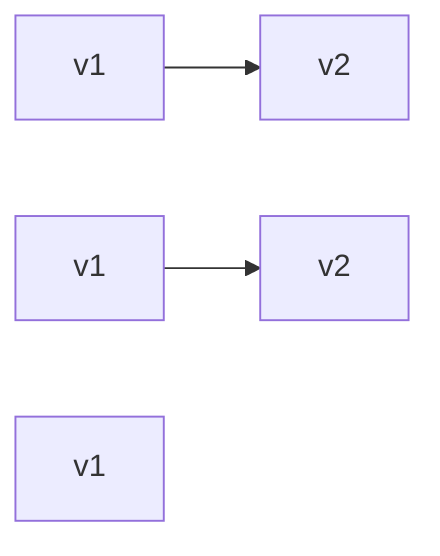


- **Pros:** no downtime, low extra infra cost
- **Cons:** **mixed versions** in production (APIs must be compatible), rollback mid-rollout is messy

**Say:** “K8s default. Cheap, zero downtime, but v1 and v2 share traffic until the last batch.”

---


### 2) Blue-Green

Two **identical** environments: **Blue** = live, **Green** = new. Deploy to Green, test, then **switch** all traffic.


|             |                                                                                    |
| ----------- | ---------------------------------------------------------------------------------- |
| **Problem** | Mixed versions during rolling are too risky (breaking API, DB).                    |
| **Solved**  | Keep a full idle copy. Flip a load balancer / Service / DNS. Rollback = flip back. |
| **Used**    | Two Deployments + one Service selector, or two namespaces / clusters.              |


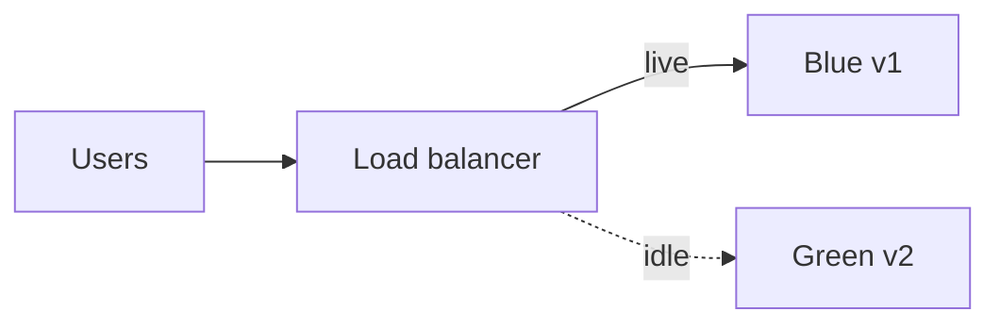


- **Pros:** instant switch, easy rollback (point back to Blue)
- **Cons:** **double infrastructure**, costlier; both must handle prod load

**Say:** “Two parks, one gate. Flip the gate. Rollback is another flip — you still pay for two parks.”

---


### 3) Canary

New version goes to a **small % of users** first. Increase if metrics stay healthy.


|             |                                                                                                                  |
| ----------- | ---------------------------------------------------------------------------------------------------------------- |
| **Problem** | Rolling still exposes *everyone* in a batch. You want **real users** but **tiny blast radius**.                  |
| **Solved**  | Send 5% traffic to v2, watch error rate / latency, then 25% → 50% → 100%. Bad canary → send everyone back to v1. |
| **Used**    | Weighted Service / Ingress, Istio, **Argo Rollouts**. Needs **monitoring** (Prometheus, Grafana).                |


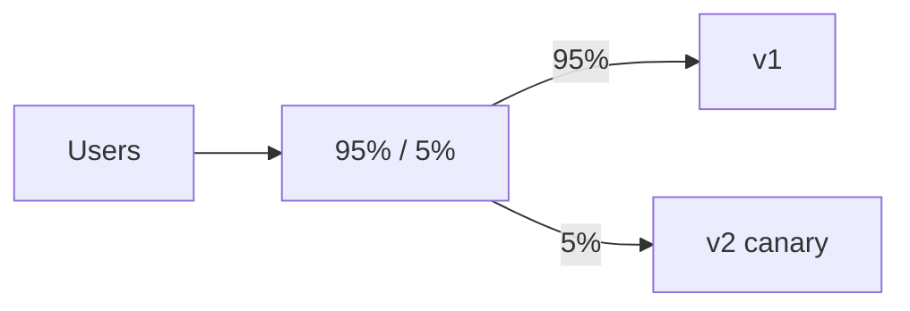


- **Pros:** low risk, validated on real traffic
- **Cons:** needs traffic splitting + strong observability

**Rolling vs Canary:** rolling replaces **instances**. Canary splits **traffic / users**. You can roll instances and still not be a canary.

**Say:** “A few real users get v2 first. If p99 or errors spike, we abort. Needs metrics, not hope.”

---


### 4) Recreate

Stop the old version **completely**, then start the new one.


|             |                                                                                                   |
| ----------- | ------------------------------------------------------------------------------------------------- |
| **Problem** | Old and new **cannot** run together (incompatible schema, one-of-a-kind resource).                |
| **Solved**  | Scale v1 to 0, then start v2.                                                                     |
| **Used**    | Kubernetes `strategy: Recreate`. Fine for **dev**, internal tools, or a job that cannot dual-run. |


- **Pros:** simple, no mixed versions
- **Cons:** **downtime**, high risk if v2 fails to start

**Say:** “Lights off, lights on. Only when two versions cannot coexist.”

---


### 5) Feature flags (release toggles)

Code is **already deployed** but the feature is **off**. Turn it on per user, group, or %.


|             |                                                                                                                              |
| ----------- | ---------------------------------------------------------------------------------------------------------------------------- |
| **Problem** | Deploy and release are the same event — every ship is a product launch.                                                      |
| **Solved**  | Ship dark. `if (flags.isOn("newCheckout", user))`. Enable for staff → 10% → everyone. Kill switch without a rollback deploy. |
| **Used**    | LaunchDarkly / Unleash / config service. Combine with rolling or canary.                                                     |


- **Pros:** **deploy ≠ release**, instant kill, targeted rollout
- **Cons:** flag debt (must delete old paths), extra complexity, need defaults if the flag service is down

**Say:** “The binary can be in prod while the feature is off. Rollback can be a flag flip, not a redeploy.”

---


### 6) Shadow / mirroring

New version gets a **copy** of real traffic. Its **response is discarded** — users still get v1.


|             |                                                                           |
| ----------- | ------------------------------------------------------------------------- |
| **Problem** | You need prod-shaped load and data, but must not serve wrong answers.     |
| **Solved**  | Proxy duplicates the request to v2. Compare latency/errors/diffs offline. |
| **Used**    | Istio **mirroring**, a sidecar, or a gateway that forks the request.      |


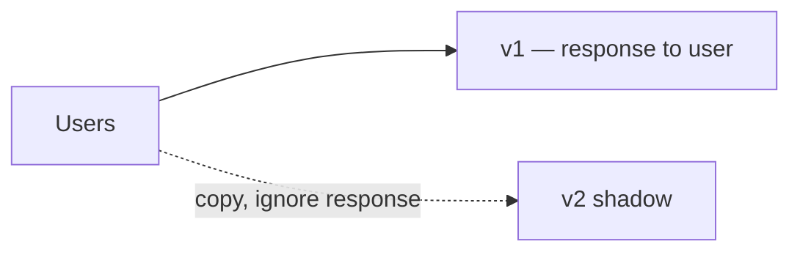


- **Pros:** safest production test (no user impact)
- **Cons:** extra cost (two full processings), must not **double-write** side effects (payments, emails) unless v2 is read-only / sandboxed

**Say:** “v2 sees real traffic but never answers the user. Great for perf; dangerous if it hits the real payment API.”

---


### Quick comparison


| Strategy          | What moves                        | Downtime | Extra infra        | Mixed versions  | Rollback                 |
| ----------------- | --------------------------------- | -------- | ------------------ | --------------- | ------------------------ |
| **Rolling**       | Instances, batch by batch         | No       | Low (`maxSurge`)   | Yes             | Roll back the Deployment |
| **Blue-Green**    | Whole environment via switch      | No       | ~2×                | No (after flip) | Flip back                |
| **Canary**        | % of **traffic / users**          | No       | Small extra pods   | Yes, on purpose | Send 100% to v1          |
| **Recreate**      | Stop then start                   | **Yes**  | None               | No              | Redeploy old             |
| **Feature flags** | Runtime boolean, not the cluster  | No       | Flag service       | By user         | Flip the flag            |
| **Shadow**        | Copied requests, unused responses | No       | Run v2 in parallel | Hidden          | Just stop mirroring      |


**Interview pick:** default **rolling** on K8s; **canary** (Argo Rollouts) for risky APIs; **blue-green** when mixed versions are forbidden; **flags** to separate deploy from release; **shadow** before a canary if side effects are contained; **recreate** only if dual-running is impossible.

---


## Interview glossary — if they say X, it means Y

Read this when a word slips. **Bold** = the name you should answer with.


| If they say…                                                       | That’s / means                                                                          | Don’t mix with                                                |
| ------------------------------------------------------------------ | --------------------------------------------------------------------------------------- | ------------------------------------------------------------- |
| **Database-per-service**, own DB, no shared tables                 | Each service owns its data; others use its **API**, never its tables                    | Shared DB (monolith-style)                                    |
| **Polyglot persistence**                                           | Different services may use different DB types                                           | One company-wide Oracle                                       |
| **Event-driven**, EDA, pub/sub                                     | Owner publishes a **fact**; others update **their copy**                                | Direct HTTP chain to every listener                           |
| **Event**, domain event                                            | **Immutable fact** that already happened (`MoneyDebited`)                               | **Command** = intent (`DebitMoney`)                           |
| **Event bus**, message bus, broker, Kafka, RabbitMQ, SNS/SQS       | Middle channel. Publisher does not know consumers                                       | Point-to-point HTTP                                           |
| **Topic / consumer**                                               | Kafka: events go on a topic; services subscribe                                         | REST endpoint                                                 |
| **Idempotent**                                                     | Safe to process the **same event twice**                                                | Exactly-once in your DB without a key                         |
| **Eventual consistency**                                           | Copies catch up **a moment later**                                                      | **Strong / immediate** consistency (one aggregate, one DB tx) |
| **Async / asynchronous**                                           | Sender does not wait                                                                    | Sync HTTP call                                                |
| **Aggregate**                                                      | Objects saved **together**; one **consistency boundary**                                | A whole microservice, or the whole DB                         |
| **Aggregate root**                                                 | Only public door. Call `order.addItem()`, not the line item                             | Child entity                                                  |
| **Invariant**                                                      | Rule that must stay true (total = sum of lines)                                         | A suggestion / UI check                                       |
| **Entity**                                                         | Has an **ID**; can change; same ID = same thing                                         | **Value object**                                              |
| **Value object**, VO                                               | **No ID**, immutable; equal if values equal (`Email`)                                   | Entity                                                        |
| **API composition**, API composer, **BFF**, **gateway aggregator** | Call each service, **merge JSON**, one payload                                          | CQRS materialized view (local copy, no live fan-out)          |
| **Fan-out**                                                        | Parallel calls (don’t wait one-by-one)                                                  | Sequential HTTP                                               |
| **CQRS**                                                           | **Command Query Responsibility Segregation** — writes and reads are **separate models** | Event sourcing (optional write-side; **not** the same)        |
| **Command**                                                        | Intent to change (`DebitMoney`)                                                         | Event (the fact after it succeeded)                           |
| **Query**                                                          | Read only; no state change                                                              | Command                                                       |
| **Write model / write DB**                                         | Normalized, for updates                                                                 | Read model                                                    |
| **Read model**, view DB, **projection**, **materialized view**     | Ready-to-read denormalized copy (`Customer Summary`)                                    | Snapshot (for aggregate load speed, not for UI)               |
| **Event sourcing**, ES                                             | Truth = **append-only event log**; replay to get state                                  | CQRS (often paired, still different)                          |
| **Event store**                                                    | Ordered log of events                                                                   | Regular CRUD table                                            |
| **Replay / time machine**                                          | Rebuild state, or state at time T, from events                                          | Re-running a saga                                             |
| **Snapshot** (ES)                                                  | Saved aggregate state every N events so replay is short                                 | Projection / materialized view                                |
| **Saga**                                                           | Distributed business flow: local **T** commits + **C** undos in **reverse**             | 2PC / one ACID tx across services                             |
| **Compensating transaction**, compensation, C-step                 | **New** undo (refund, cancel) — not a global DB rollback                                | `ROLLBACK` of a 2PC lock                                      |
| **Choreography**                                                   | No boss. Each service listens and does the **next** step (events)                       | Orchestration                                                 |
| **Orchestration**, saga manager, conductor                         | **One boss** sends commands and sequences T/C                                           | Choreography                                                  |
| **2PC**, two-phase commit, **XA**                                  | All commit or all abort: **PREPARE** then **COMMIT**. Locks. Course says **avoid**      | Saga / outbox                                                 |
| **Coordinator** (2PC)                                              | Asks all resource managers to vote, then decide                                         | Saga orchestrator (no global lock)                            |
| **Dual-write problem**                                             | Crash after DB / before Kafka → lost event                                              | Solved by **outbox**, not by hoping                           |
| **Transactional outbox**, outbox                                   | Business row + outbox row in **one local DB tx**; later poller/**CDC** → Kafka          | 2PC across DB + Kafka                                         |
| **CDC**, Debezium                                                  | Change Data Capture — DB log → Kafka                                                    | App polling if you use Debezium                               |
| **DDD**, domain-driven design                                      | Software **looks like the business**; same words in code                                | “We have microservices” (not enough)                          |
| **Domain**                                                         | The business you are in (banking, Netflix)                                              | A Java package only                                           |
| **Subdomain**                                                      | A slice of that business (billing vs streaming)                                         | A random module                                               |
| **Core domain**                                                    | The slice that makes you money                                                          | Generic billing/HR                                            |
| **Ubiquitous language**                                            | Same words in meetings **and** in code                                                  | `UserDto` when the business says subscriber                   |
| **Bounded context**                                                | Wall around **one model + one language** (Billing: subscriber, Streaming: viewer)       | One `Customer` class for the whole company                    |
| **Context map**                                                    | Who talks to whom, how, in which direction                                              | A random architecture diagram                                 |
| **Anti-corruption layer**, **ACL**                                 | Translator at the boundary so models don’t leak                                         | Skipping translation and sharing entities                     |
| **Repository** (DDD)                                               | Load/save **aggregates** by id                                                          | A DAO for every table                                         |
| **Domain service**                                                 | Logic that doesn’t fit **one** aggregate                                                | Putting everything in a Spring `@Service`                     |
| **Strategic DDD**                                                  | Subdomains, language, bounded contexts, map, ACL                                        | Tactical (entity, VO, aggregate)                              |
| **Tactical DDD**                                                   | Entity, value object, aggregate, repository, domain service                             | Strategic                                                     |
| **Strangler Fig**, strangler                                       | Replace a monolith **feature by feature** behind a gateway                              | Big-bang rewrite                                              |
| **Hexagonal**, **ports and adapters**                              | Core knows no HTTP/SQL. **Ports** = contracts; **adapters** = tech                      | Three-tier with Spring in the domain                          |
| **Port**                                                           | Interface **owned by the core** (`save`, `load`)                                        | `IUserJpaRepository`                                          |
| **Adapter**                                                        | Converts port ↔ REST / Kafka / Postgres                                                 | The domain itself                                             |
| **Driving / inbound / left**                                       | Outside **pushes** the app (REST, queue consumer)                                       | Driven                                                        |
| **Driven / outbound / right**                                      | App **calls** outside (DB, email, other service)                                        | Driving                                                       |
| **BDD**                                                            | Behavior specs: **Given / When / Then** (Cucumber)                                      | Only UI click tests                                           |
| **GoF**, Gang of Four                                              | Book of **23** patterns: creational / structural / behavioral                           | Architecture patterns (saga, CQRS)                            |
| **Creational**                                                     | How objects are **created**                                                             | Structural / behavioral                                       |
| **Structural**                                                     | How objects **fit together**                                                            | Creational / behavioral                                       |
| **Behavioral**                                                     | How objects **talk / change behavior**                                                  | Creational / structural                                       |
| **Singleton**                                                      | **One** instance (or a Spring bean)                                                     | Global mutable soup; prefer the container                     |
| **Prototype**                                                      | **Clone** an existing object (`clone()` / copy ctor)                                    | `new` from scratch                                            |
| **Builder**                                                        | Build **step by step** / fluent (`ketchup().mustard().build()`)                         | Factory (factory picks **type**)                              |
| **Factory**, factory method                                        | Hide `new`; a method picks the **class**                                                | Builder; **Abstract Factory** = factory of families           |
| **Facade**                                                         | One **simple API** over a messy subsystem                                               | **Proxy** (same API of **one** object)                        |
| **Proxy**                                                          | **Same interface**, extra work, then delegate (cache, deny, lazy)                       | Adapter (changes API); Decorator (stacks extra behavior)      |
| **Adapter** (GoF)                                                  | **Changes** the interface so two types can talk                                         | Proxy / Facade                                                |
| **Decorator**                                                      | **Adds** behavior; can stack wrappers                                                   | Proxy (access control, usually 1:1)                           |
| **Iterator**                                                       | **Pull** next item (`for-each`)                                                         | Observer (push)                                               |
| **Observer**                                                       | **Push** to many subscribers (radio tower)                                              | Mediator; Kafka is Observer at service scale                  |
| **Mediator**                                                       | Middleman so colleagues **don’t talk many-to-many** (ATC)                               | Observer (broadcast, not coordination)                        |
| **State**                                                          | Same API, behavior follows **internal state** (order status classes)                    | **Strategy** (injected algorithm, not lifecycle)              |
| **Strategy**                                                       | Swap **how** (`Comparator`, pay by card vs wallet) — same caller, different algorithm   | A growing `if/else` in checkout                               |
| **Rolling**, RollingUpdate                                         | Replace **pods** batch by batch; mixed versions                                         | Canary (that splits **traffic %**)                            |
| **Blue-Green**, blue/green                                         | Two full envs; **flip** traffic; easy rollback                                          | Canary; costs ~2×                                             |
| **Canary**                                                         | Small **% of users/traffic** get v2 first                                               | Rolling (instances, not traffic split)                        |
| **Recreate**                                                       | Stop old, start new → **downtime**                                                      | Rolling                                                       |
| **Feature flags**, feature toggles, release toggles, dark launch   | Code is deployed; feature **off** until you flip it. Deploy ≠ release                   | Canary (cluster traffic vs runtime boolean)                   |
| **Shadow**, mirroring, traffic mirroring                           | v2 gets a **copy** of requests; **user still gets v1**                                  | Canary (canary **does** serve users)                          |


